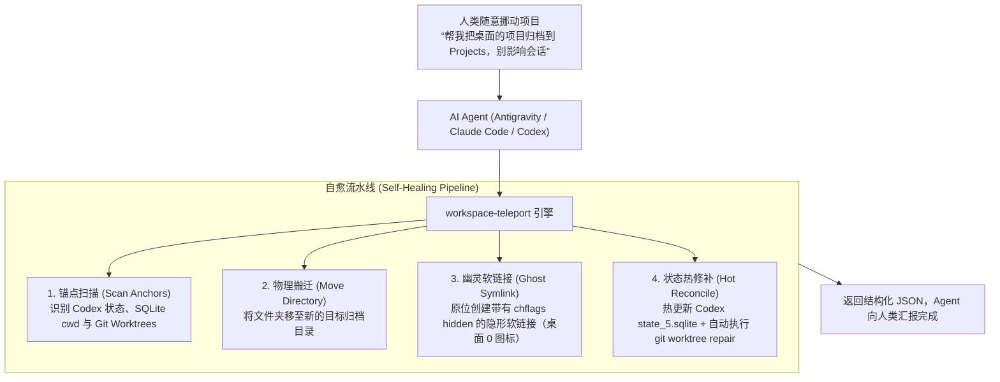

<div align="center">

# 🚀 Workspace Teleport

**专为 AI Agent（Claude Code / Antigravity / Codex / Cursor / DeepSeek）设计的智能工作区迁移与自愈引擎**

*解决现代开发者的“路径锚定困境”（Path Anchoring Dilemma）：随时随地整理桌面和下载目录，会话与 Git Worktree 永不断链。*

[English Documentation](README_EN.md) · [Agent Skill 规范](SKILL.md)

</div>

---

### ❓ 什么是“路径锚定困境”（Path Anchoring Dilemma）？

现代开发者的真实日常是：
1. **随手建项目**：在桌面新建文件夹 `~/Desktop/my-app`，直接拖入 Codex 或 Claude Code 开始高速对话；
2. **状态被硬绑定**：Codex 的数据库、会话历史、Git Worktrees 悄悄在本地硬编码了绝对物理路径 `/Users/.../Desktop/my-app`；
3. **想整理却不敢动**：几天后桌面堆满了几十个项目，一移动文件夹，Codex 就会报 `Directory not found`，Git worktree 也会报错 `fatal: not a valid git repository`；
4. **反人性的规训**：有人建议“一开始就必须按规范建目录”——但这违背了人类追求灵感与心流的本能。脏活累活本来就该由 AI Agent 搞定。

**`workspace-teleport` 为此而生**：它让用户可以任意搬家、随手整理桌面，AI Agent 在后台通过**隐形穿透链接 + 状态自愈修补**，保证会话与工作区无感继续工作！

---

### 🌟 核心工作流与架构原理



#### 双重保险机制（200% 安全保证）：
1. **幽灵影子软链接（Ghost Symlink）**：
   * 在旧位置原位留下符号链接，并打上 macOS 的 `chflags hidden` 标记；
   * **Finder 桌面完全不可见（视觉一尘不染）**，但任何命令行、旧脚本、IDE 依然能通过透明穿透访问。
2. **底层状态热修补（State Healer）**：
   * 自动备份并更新 `~/.codex/.codex-global-state.json`；
   * 自动在 `~/.codex/state_5.sqlite` 中更新当前会话的 `threads.cwd`；
   * 自动触发 `git worktree repair`，秒级重连所有断开的树。

---

### 📦 安装方式

#### 方式 1：一键脚本安装
```bash
curl -fsSL https://raw.githubusercontent.com/isdou/workspace-teleport/main/install.sh | bash
```

#### 方式 2：Python pip 安装
```bash
git clone https://github.com/isdou/workspace-teleport.git
cd workspace-teleport
pip3 install -e .
```

---

### 💻 CLI 命令详解

#### 1. 扫描目录中的锁定状态 (`scan`)
智能识别目录下哪些项目被 Codex / Git Worktree 绑定，哪些是完全自由的闲置文件：
```bash
workspace-teleport scan ~/Desktop
```
*输出示例：*
```text
📂 Directory: /Users/suxiaohan/Desktop
📊 Total items: 65 | 🔒 Locked by Codex/Git: 22 | ✨ Free to organize: 43

STATUS   TYPE   NAME
--------------------------------------------------
🔒 LOCK   DIR    xiaodou
🔒 LOCK   DIR    dou.os
✨ FREE   FILE   Letters_Demo.mp4
✨ FREE   DIR    old-assets
```

#### 2. 无感迁移项目 (`move`)
移动项目至新路径，自动完成影子穿透与数据库自愈：
```bash
workspace-teleport move ~/Desktop/my-project ~/Projects/
```
*可选参数：*
* `--dry-run`：试运行预览，不实际修改文件
* `--mode both`（默认）：同时建立隐形软链接并热修补数据库
* `--json`：输出标准 JSON 报告（供 Agent 解析）

#### 3. 批量归档自由文件 (`batch-free`)
一键将所有未被任何工具绑定的闲置文件/过期文件夹收拢到归档目录中：
```bash
workspace-teleport batch-free ~/Desktop ~/Desktop/Archive
```

---

### 🤖 Agent 集成（Claude Code / Antigravity / Cursor / Codex）

本项目原生支持作为 **AI Agent Skill** 使用！

将仓库中的 [`SKILL.md`](SKILL.md) 放入您 Agent 的技能目录（例如 `~/.gemini/config/skills/workspace-teleport/SKILL.md` 或 Claude Code 工具库）。

人类只需要自然说话：
> **人类**：“帮我把桌面上闲置的文件和临时素材归档一下。”  
> **Agent**：自动调用 `workspace-teleport batch-free`，秒级清爽。

> **人类**：“把桌面的 `xiaodou` 挪到 `~/Projects`，别影响正在进行的对话。”  
> **Agent**：自动调用 `workspace-teleport move`，完成物理搬迁 + 隐形影子链接 + 数据库修补，会话继续无缝进行。

---

### 📄 开源许可证

本项目采用 [MIT License](LICENSE) 开源。欢迎提 Issue 和 Pull Request！
