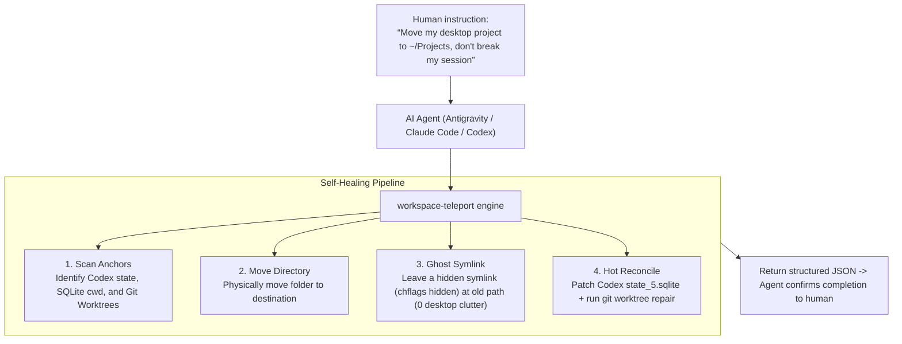

<div align="center">

# 🚀 Workspace Teleport

**AI Agent-Native Workspace & Project Relocation Engine**  
*Built for Claude Code, Antigravity, Codex, Cursor, and DeepSeek.*

*Solves the "Path Anchoring Dilemma": Reorganize your desktop and downloads anytime, without breaking IDE sessions or Git Worktrees.*

[中文文档](README.md) · [Agent Skill Spec](SKILL.md)

</div>

---

### ❓ What is the "Path Anchoring Dilemma"?

The daily reality for modern developers:
1. **Spontaneous Creation**: You create `~/Desktop/my-app` and drag it into Codex or Claude Code for deep AI programming.
2. **Hardcoded Anchors**: Codex databases, session threads, and Git Worktrees silently store hardcoded absolute paths `/Users/.../Desktop/my-app`.
3. **Cluttered Desktops**: Weeks later, the desktop is flooded with 50+ projects. Moving any folder breaks Codex with `Directory not found` and Git with `fatal: not a valid git repository`.
4. **Counter-Intuitive Discipline**: Forcing developers to "organize folders upfront" goes against human flow. Dirty work belongs to AI agents.

**`workspace-teleport` solves this completely**: Relocate any project folder freely. The background engine creates macOS-invisible ghost symlinks and patches Codex/Git internal state automatically!

---

### 🌟 Architecture & Self-Healing Pipeline



#### Dual-Layer Resilience:
1. **Ghost Symlinks (`chflags hidden`)**:
   * A POSIX symlink is placed at the original location with macOS `chflags hidden`.
   * Completely invisible on the Finder Desktop, yet 100% transparent to CLI tools and legacy scripts.
2. **State Hot-Patching (Self-Healer)**:
   * Auto-patches `~/.codex/.codex-global-state.json`.
   * Updates `threads.cwd` in `~/.codex/state_5.sqlite`.
   * Automatically executes `git worktree repair` to re-align worktrees.

---

### 📦 Installation

#### Option 1: One-liner Script
```bash
curl -fsSL https://raw.githubusercontent.com/isdou/workspace-teleport/main/install.sh | bash
```

#### Option 2: Pip Install
```bash
git clone https://github.com/isdou/workspace-teleport.git
cd workspace-teleport
pip3 install -e .
```

---

### 💻 CLI Usage

#### 1. Scan Directory Anchors (`scan`)
Distinguishes between locked active projects and free unanchored clutter:
```bash
workspace-teleport scan ~/Desktop
```

#### 2. Relocate Project Safely (`move`)
Moves a project, generates ghost symlinks, and self-heals IDE state:
```bash
workspace-teleport move ~/Desktop/my-project ~/Projects/
```

#### 3. Batch Archive Free Items (`batch-free`)
Instantly moves unanchored files and folders into an archive:
```bash
workspace-teleport batch-free ~/Desktop ~/Desktop/Archive
```

---

### 🤖 Agent Integration

This tool natively operates as an **AI Agent Skill**!

Include [`SKILL.md`](SKILL.md) in your Agent's skill library. Humans simply speak naturally:
> *"Clean up my desktop clutter."* ➔ Agent runs `workspace-teleport batch-free`.  
> *"Archive `my-project` to `~/Projects` without breaking my ongoing chat."* ➔ Agent runs `workspace-teleport move`.

---

### 📄 License

MIT License © 2026 isdou. Contributions and issues welcome!
